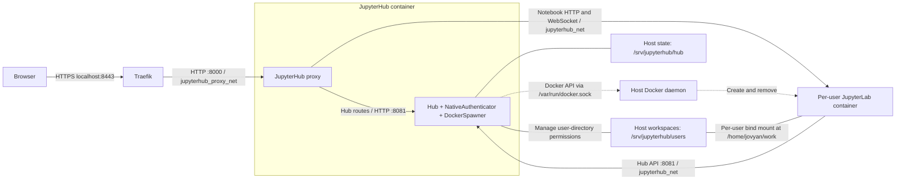

# Containerized JupyterHub for scientific computing

A self-hosted JupyterHub deployment for a university-style scientific computing environment. Each user gets an isolated JupyterLab container with scientific Python and CERN ROOT, while notebooks and user-created Conda environments persist on the host.

## Architecture



Solid arrows show application traffic; dotted arrows show container lifecycle management. Undirected lines show bind mounts. NativeAuthenticator and DockerSpawner run within the Hub process; the proxy runs in the same container. Traefik only joins `jupyterhub_proxy_net` and has no Docker socket access. The Hub container also joins `jupyterhub_net` to reach notebook servers. Storage paths shown are host defaults, configurable through `JUPYTERHUB_HUB_DIR` and `JUPYTERHUB_USERS_DIR`; each notebook mounts only its own user subdirectory.

### Design choices

- **Per-user containers:** DockerSpawner creates notebook servers on the `jupyterhub_net` network and removes containers when servers stop. Traefik sits on a separate `proxy_net` with the Hub and cannot reach user containers.
- **Persistent workspaces:** host directories are mounted at `/home/jovyan/work`; data survives container replacement.
- **Persistent environments:** user Conda environments and package caches live inside the workspace.
- **Scientific stack:** NumPy, SciPy, Matplotlib, pandas, SymPy, ipykernel, and ROOT are installed in the notebook image.
- **Resource controls:** each notebook container is limited to 2 GB RAM and 1 CPU, with numerical-library thread counts set to one.
- **Basic isolation:** notebook containers drop Linux capabilities, disable privilege escalation, and limit process counts. On native Linux hosts, optional firewall rules block traffic between user containers and towards the host and LAN (see [Linux network isolation](#linux-network-isolation)).

This repository captures a working deployment, not a production-hardened platform. See [security considerations](docs/operations.md#security-and-exposure) before exposing it to a network.

## Repository layout

| Path | Purpose |
| --- | --- |
| `compose.yml` | Traefik and JupyterHub services and Docker network |
| `jupyterhub/Dockerfile` | Hub image with DockerSpawner and NativeAuthenticator |
| `jupyterhub/jupyterhub_config.py` | Authentication, spawning, storage, and resource policy |
| `singleuser/Dockerfile` | Scientific JupyterLab image, including ROOT |
| `singleuser/register-conda-kernel.py` | Helper for registering user-created Python environments |
| `notebooks/` | PyROOT and ROOT C++ demonstration notebooks |
| `tests/` | Standard-library tests for the kernel helper and host storage mapping |
| `docs/operations.md` | Administration, persistence, security, and troubleshooting |
| `traefik/dynamic/jupyterhub.yml` | Static Traefik route, rate limit and security headers (Traefik has no Docker socket access) |
| `deploy_linux/` | Linux-only network isolation (iptables script and systemd unit); not yet tested |

## Prerequisites

- A Linux Docker host with Docker Engine and Docker Compose v2.
- Access to `/var/run/docker.sock` and administrative access to create `/srv/jupyterhub` directories.
- Available host ports **8000** (HTTP redirect) and **8443** (HTTPS application).
- `mkcert` for locally trusted development certificates.
- Internet access to pull images and install Python/Conda dependencies during builds.
- Sufficient RAM and disk space for ROOT builds, notebook containers, and persistent user environments.

Linux storage defaults are preserved. Docker Desktop on macOS (Apple Silicon) has also been smoke-tested with configurable absolute host paths; see [validation results](docs/validation.md). Desktop bind-mount ownership semantics are not identical to native Linux.

## Build and start

### Generate development certificates

On macOS:

```sh
brew install mkcert
mkcert -install
mkdir -p traefik/certs
mkcert -cert-file traefik/certs/local.pem \
  -key-file traefik/certs/local-key.pem localhost 127.0.0.1 ::1
```

On other systems, install [mkcert](https://github.com/FiloSottile/mkcert) using its platform instructions, then run the certificate commands above. `mkcert -install` adds a local development CA to your trust store. Never share the CA private key or commit certificate/private-key files; `*.pem` is ignored by Git. Other clients must trust the issuing CA to validate these certificates.

Traefik loads the certificate paths from `traefik/dynamic/tls.yml`. This is development TLS, not publicly trusted production TLS.

### Start the services

Run from the repository root. Compose references local image tags rather than building images automatically:

```sh
docker build -t jupyterhub-scientific-hub:0.1.0 ./jupyterhub
docker build -t jupyterhub-scientific-notebook:0.1.0 ./singleuser

sudo mkdir -p /srv/jupyterhub/hub /srv/jupyterhub/users
sudo chmod 700 /srv/jupyterhub/hub /srv/jupyterhub/users

docker compose config --quiet
docker compose up -d
docker compose logs -f jupyterhub
```

Open **https://localhost:8443**. HTTP on `http://localhost:8000` redirects to HTTPS. Both published ports are loopback-only, the router expects the hostname `localhost`, and the Traefik dashboard is disabled. Traefik terminates TLS; traffic to JupyterHub remains HTTP on the Docker network.

**Authentication is intentionally locked down:** the committed configuration names `jhubadmin` as administrator and in the allowlist, with `open_signup = False`. An existing installation uses its persisted authentication database. On a new installation, sign up as `jhubadmin` at `/hub/signup`; NativeAuthenticator automatically authorizes configured administrators. Starting the containers alone does not create a password. See [account administration](docs/operations.md#account-administration).

### Docker Desktop storage paths

Copy `.env.example` to `.env` and set **absolute** paths in your home directory, for example:

```dotenv
JUPYTERHUB_HUB_DIR=/Users/yourname/jupyterhub-data/hub
JUPYTERHUB_USERS_DIR=/Users/yourname/jupyterhub-data/users
```

Create those directories instead of the `/srv` directories above. Ensure Docker Desktop can share them. The users path is passed to DockerSpawner because bind-mount sources are resolved by the Docker daemon on the host, not inside the Hub container. Do not set a relative path or a literal `~`.

The notebook image tag used by DockerSpawner is configured in `jupyterhub/jupyterhub_config.py`, not in Compose. When changing image tags, update the corresponding configuration too.

Dependencies in the notebook image are not version-locked, and its base tag can change upstream. Rebuilding the same tag is not guaranteed to produce identical contents. Both project images use release tag `0.1.0`; upstream packages keep their own versions. This identifies the PoC release, not production readiness or reproducible builds.

## Scientific computing demos

Upload the files from `notebooks/` into a running user's workspace; they are not automatically copied into the image or mounted by Compose.

- [`notebooks/pyroot.ipynb`](notebooks/pyroot.ipynb): NumPy/Matplotlib plotting and a Gaussian histogram using PyROOT.
- [`notebooks/croot.ipynb`](notebooks/croot.ipynb): C++ execution and histogram rendering with the ROOT kernel.

In the JupyterLab terminal, check the installation:

```sh
python -c 'import ROOT; print(ROOT.gROOT.GetVersion())'
jupyter kernelspec list
```

Select the Python kernel for PyROOT and the ROOT C++ kernel for the C++ notebook. If the ROOT kernel is missing, inspect the installed package's kernel registration; the Python helper below registers **ipykernel**, not C++ kernels. Saved notebook outputs have been removed so the examples can be rerun in the deployed environment.

## User-created Python environments

From a user's JupyterLab terminal:

```sh
mamba create -y -n analysis python=3.12 ipykernel numpy matplotlib
register-conda-kernel analysis --display-name "Python (analysis)"
```

The helper searches `CONDA_ENVS_PATH` and installs a kernelspec under:

```text
/home/jovyan/work/.jupyter/share/jupyter/kernels/analysis
```

Both the environment and kernelspec persist because they live inside the mounted workspace. The spawner sets `JUPYTER_PATH` to include the persistent kernelspec directory. Refresh JupyterLab after registration; see [kernel discovery](docs/operations.md#kernel-discovery) if the kernel is not listed.

## Local checks

The unit tests need Python 3.10+ and no third-party dependencies or Docker daemon:

```sh
python3 -m unittest discover -s tests -v
```

GitHub Actions also checks Python syntax and Compose structure. These are static/unit checks, not end-to-end verification of login, spawning, or ROOT installation.

## Linux network isolation

> **Status: untested.** The stack is developed and verified on macOS (Docker Desktop). The files in `deploy_linux/` require a native Linux Docker Engine host and must be validated on first deployment.

Docker Desktop runs containers inside a VM, so host firewall rules cannot affect them. On native Linux, `deploy_linux/jhub-net-rules.sh` blocks traffic between user containers, from user containers to the host, LAN and cloud metadata addresses, and allows only the Hub API (tcp/8081) towards the Hub. Internet access stays open for conda and pip.

1. Find your real DNS resolvers (`grep nameserver /etc/resolv.conf`, or `resolvectl status` if you see `127.0.0.53`) and set them in `DNS_SERVERS` inside the script. The script refuses to run until you do.
2. Install the script and the unit, then enable it after the stack is up:

```sh
sudo install -m 755 deploy_linux/jhub-net-rules.sh /usr/local/sbin/jhub-net-rules.sh
sudo install -m 644 deploy_linux/jhub-net-rules.service /etc/systemd/system/jhub-net-rules.service
sudo systemctl daemon-reload
docker compose up -d
sudo systemctl enable --now jhub-net-rules.service
sudo iptables -L JHUB-USERS -v -n
```

3. From a user's JupyterLab terminal, internet access must work while the Docker host (`172.30.250.1`) and the LAN gateway time out. Two throwaway containers on `jupyterhub_net` must not be able to ping each other.

To roll back: `sudo systemctl disable --now jhub-net-rules.service`. If the `DOCKER-USER` chain does not exist, the host uses Docker's nftables backend and equivalent nft rules are needed. If you change the subnet, update `ipv4_address` in `compose.yml`, `HUB_IP` in `jupyterhub_config.py` and `HUB_IP` in the script.

## Operations and limitations

See [the operations guide](docs/operations.md) for account policy, backups, image updates, and troubleshooting. Current limitations include development-only certificate trust, privileged Docker socket access for the Hub, and manually managed user storage and backups. Public deployment requires an appropriate hostname, publicly trusted certificates, and further operational/security hardening.

No credentials, Hub database, cookie secrets, or user workspaces belong in this repository.

## Institutional deployment considerations

This repository provides a reusable, containerized scientific computing stack for research and education. It is designed to be adapted to different institutional environments rather than prescribing a specific authentication or infrastructure policy.

Before deploying the stack as a production service, institutions should address the following requirements:

* Institutional authentication and authorization: Integrate JupyterHub with the institution’s identity management system (e.g., OAuth2/OIDC, LDAP, or SAML through an appropriate authenticator). Define user access policies and ensure stable, unique user identifiers for persistent workspace mapping.
* Public HTTPS configuration: Configure an institution-specific hostname, publicly trusted TLS certificates, and appropriate network exposure.
* Security hardening: Review Docker socket access, container isolation, network segmentation, and security policies for potentially untrusted user workloads.
* Data protection and operations: Establish automated backups with tested restoration procedures, storage quotas, monitoring, and appropriate data retention policies.
* Reliability and reproducibility: Consider dependency locking, validate concurrent-user capacity through load testing, and establish tested upgrade and rollback procedures.

Institution-specific authentication and authorization are intentionally outside the scope of the default deployment. The stack provides a working local authentication configuration, which institutions can replace or extend according to their requirements.

Production deployment requires an independent security and operational review appropriate to the intended environment.

## License

Project code and documentation are licensed under the [BSD 3-Clause License](LICENSE). Third-party images and dependencies, including CERN ROOT, retain their own licenses; the project license does not relicense those components.
